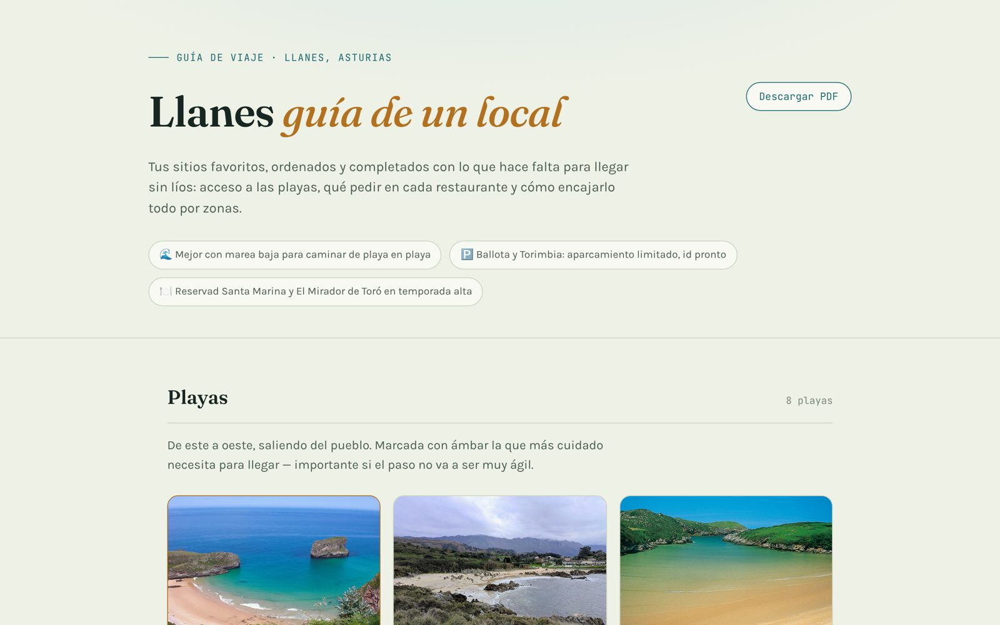

# Llanes · guía de un local

A printable travel guide to Llanes (Asturias, Spain), written the way a local would explain it to a friend: which beaches are worth it and how to reach them, what to order in each restaurant, and how to group everything by area so a day out flows without backtracking.

**Live site:** https://angelcandas.github.io/llanes-guia/



## What's inside

- **Beaches**: 8 beaches from east to west, with access notes. The one that needs the most care to reach is highlighted.
- **Restaurants**: what to order and when to book.
- **Sights and walks**: town landmarks, coastal routes and nearby villages.
- **By area**: everything regrouped by zone so you can plan each day.
- **Download as PDF**: a print stylesheet turns the page into a clean, offline-friendly guide.

## Tech

- React 19 + Vite 6, no UI framework; hand-written CSS with a print stylesheet
- Content lives in plain data files (`src/data/*.js`), so updating the guide doesn't mean touching components
- Deployed to GitHub Pages by a GitHub Actions workflow on every push to `main`

## Run locally

```bash
npm install
npm run dev      # http://localhost:5173/llanes-guia/
npm run build    # production build in dist/
```

## Photos

Photos are in `public/images/`. Photo credits are shown on the page next to each section.
